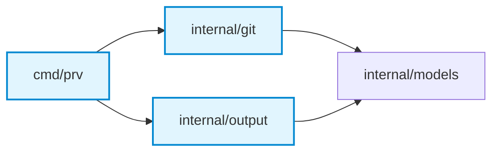

<div align="center">

# `prv`

### High-Velocity Pull Request Review Context Engine & CLI

[](https://github.com/vubon/prv/actions/workflows/ci.yml)
[](https://github.com/vubon/prv/releases)
[](https://go.dev)
[](https://conventionalcomments.org)
[](LICENSE)

*Turn noisy git diffs into structured, high-signal review contexts, auto-generated Mermaid architecture diagrams, and 1-click Conventional Comment suggestions for AI-assisted and human code reviews.*

---

[Key Features](#-key-features) •
[Installation](#-installation) •
[Quickstart](#-quickstart--workflows) •
[CLI Reference](#-cli-command-reference) •
[Configuration](#-configuration-prvyaml) •
[AI Pairing](#-pairing-with-ai-agents)

</div>

<br />

## 💡 Why `prv`?

Reviewing Pull Requests—whether as a human engineer or with an LLM agent—is often derailed by **diff noise**:
- Massive lockfiles (`package-lock.json`, `go.sum`, `Cargo.lock`), generated code, and minified bundles obscure core logic.
- Reviewers lack architectural context: *Which packages are impacted? Where is the highest blast radius?*
- Uncommitted local changes lack a fast, private pre-commit review mechanism before code reaches GitHub.
- Review suggestions often lack standard structure or copy-ready line replacements, causing tedious back-and-forth.

**`prv` solves this.** It parses local git repositories or GitHub PRs, eliminates noise, auto-generates architectural impact diagrams and collapsible file walkthroughs, and produces formatted Conventional Comments with drop-in GitHub suggestion blocks.

---

## ⚡ Key Features

| Feature | Description |
| :--- | :--- |
| 🧹 **Zero-Noise Bundling** | Automatically filters lockfiles, vendor directories, minified bundles, test fixtures, and binary assets. |
| 🔒 **Pre-Commit Self-Reviews** | Run `prv bundle --staged` to evaluate uncommitted changes privately before pushing or committing. |
| 🗺️ **Mermaid Architecture Diagrams** | Run `prv diagram` to auto-parse changed Go/project files and generate interactive component diagrams. |
| 📂 **Collapsible Walkthroughs** | Run `prv walkthrough` to generate `<details>` summaries with line stats and topic tags per file. |
| 💬 **Conventional Comments Standard** | Formats findings strictly into `<label> [decorations] (<subject>): <title>` with drop-in ````suggestion ```` blocks. |
| 🚀 **GitHub Review API Dispatch** | Post full PR reviews with line-level diff comments directly using `prv report --inline --post`. |
| 🛡️ **Defensive 422 Recovery** | Catches GitHub diff-anchoring mismatches automatically to guarantee review findings are never lost. |
| ⚙️ **Custom Repository Rules** | Configure `.prv.yaml` to enforce team guidelines, sensitive file alerts, and custom ignore rules. |

---

## 📦 Installation

### Option 1: Pre-built Binary (Recommended)

Download the binary for your operating system and architecture from [GitHub Releases](https://github.com/vubon/prv/releases/latest):

```bash
# macOS (Apple Silicon M-series)
curl -LO https://github.com/vubon/prv/releases/latest/download/prv_darwin_arm64.tar.gz
tar -xzf prv_darwin_arm64.tar.gz
sudo mv prv /usr/local/bin/

# Linux (x86_64)
curl -LO https://github.com/vubon/prv/releases/latest/download/prv_linux_amd64.tar.gz
tar -xzf prv_linux_amd64.tar.gz
sudo mv prv /usr/local/bin/
```

> **macOS Note:** If Gatekeeper prompts on first run, clear the quarantine attribute:
> ```bash
> xattr -d com.apple.quarantine /usr/local/bin/prv
> ```

### Option 2: Go Install

If you have Go 1.26+ installed:

```bash
go install github.com/vubon/prv/cmd/prv@latest
```

### Option 3: Build from Source

```bash
git clone https://github.com/vubon/prv.git
cd prv
make check
make build
# Binary built at ./bin/prv
```

---

## 🚀 Quickstart & Workflows

### 1. Pre-Commit Local Self-Review

Catch logic errors, missing tests, or accidental secret leaks *before* committing:

```bash
# 1. Stage your working changes
git add internal/auth/ internal/db/

# 2. Bundle staged changes with repo rules and sensitive path checks
prv bundle --staged

# 3. Pipe directly into your clipboard for AI review
prv bundle --staged --copy
```

---

### 2. Bundle Context for a Feature Branch or PR

Prepare an AI-ready context bundle for a teammate's PR or branch:

```bash
# By branch name (compares against main by default)
prv bundle --branch feat/user-auth

# Against a custom base branch
prv bundle --branch feat/user-auth --base staging

# By GitHub PR number or full URL
prv bundle --pr 42
prv bundle --pr https://github.com/owner/repo/pull/42
```

---

### 3. Generate Visual Architecture & Impact Diagrams

Inspect structural blast radius and package couplings:

```bash
# Generate Mermaid diagram for current branch changes
prv diagram

# Generate diagram from uncommitted staged changes
prv diagram --staged

# Output raw Mermaid syntax or markdown code block
prv diagram --raw
```

**Example Rendered Output:**


---

### 4. Generate Collapsible File Walkthroughs

Create CodeRabbit-style interactive file walkthroughs:

```bash
# Generate file-by-file summary
prv walkthrough

# From staged changes
prv walkthrough --staged
```

**Example Output:**
```markdown
<details>
<summary><b>internal/git/github.go</b> (+48 / -3) — <i>API transport & fallback</i></summary>

- Implemented `PostPRReview` with dual CLI and REST API fallback.
- Added stderr diagnostics on diff-anchoring retries.
</details>
```

---

### 5. Format & Publish Review Reports

Save reviews, copy comments to clipboard, or post directly to GitHub:

```bash
# Save formatted markdown report into reviews/ directory
prv report --file review_output.json

# Post top-level review comment to GitHub PR
prv report --file review_output.json --post 42

# Post full review with line-level inline diff comments
prv report --file review_output.json --inline --post 42

# Copy formatted Conventional Comments to system clipboard
prv report --file review_output.json --copy
```

---

## 📋 Conventional Comments Standard

`prv` strictly enforces the [Conventional Comments](https://conventionalcomments.org) specification:

```
<label> [decorations] (<subject>): <title>

[discussion / reason]

```suggestion
[exact drop-in replacement code]
```
```

### Supported Labels & Icons

| Icon | Label | Usage |
| :---: | :--- | :--- |
| 🚨 | `blocking` | Prevents merge (critical bugs, data loss, security vulnerabilities). |
| ⚠️ | `issue` | Problem that should be resolved before merge. |
| 🔒 | `security` | Authentication, authorization, OWASP risks, or secret leakage. |
| ⚡ | `performance` | Algorithmic complexity, memory allocations, or N+1 queries. |
| 💡 | `suggestion` | Improvements, refactoring, or idiomatic patterns (non-blocking). |
| 🔍 | `nit` | Minor styling, spelling, or formatting preference. |
| ❓ | `question` | Inquiries regarding intent, trade-offs, or edge cases. |
| 👏 | `praise` | Recognition of elegant architecture or clean solutions. |

---

## ⚙️ Configuration (`.prv.yaml`)

Initialize a repository configuration file with:

```bash
prv init
```

### Example `.prv.yaml`

```yaml
version: 1

rules:
  - "All exported functions must include godoc comments."
  - "No raw SQL queries without parameterized statements."
  - "Table-driven unit tests required for all new logic."

sensitive_paths:
  - "internal/auth/**"
  - "config/secrets.go"
  - "migrations/**"

ignore_patterns:
  - "*.pb.go"
  - "*.generated.go"
  - "dist/**"

review_matrix:
  - name: "Intent & Spec Alignment"
  - name: "Logic & Bug Detection"
  - name: "Security & Data Safety"
  - name: "Performance & Scalability"
  - name: "Testing & Verification"
  - name: "Clean Code & Style"
  - name: "Architecture & System Coupling"
  - name: "Observability & Operability"
  - name: "Blast Radius & The Weakest Link"
```

---

## 🤖 Pairing with AI Agents

`prv` is designed to be the foundational context engine for AI pair programmers and autonomous agents (Antigravity, Claude Code, Cursor, Copilot CLI):

```
┌──────────────┐       prv bundle       ┌──────────────┐      AI Prompt       ┌──────────────┐
│  Git Diff &  │ ─────────────────────> │  High-Signal │ ───────────────────> │  Advisory    │
│  Repository  │                        │  Context Doc │                      │  Review      │
└──────────────┘                        └──────────────┘                      └──────────────┘
                                                                                     │
                                                                                     │ Human Review Gate
                                                                                     ▼
┌──────────────┐    prv report --copy   ┌──────────────┐   1-Click Commit     ┌──────────────┐
│  GitHub PR   │ <───────────────────── │ Copy-Ready   │ <─────────────────── │ Verified     │
│  Comments    │                        │ Suggestions  │                      │ Findings     │
└──────────────┘                        └──────────────┘                      └──────────────┘
```

### Human-in-the-Loop Safeguards
1. **Never auto-post without review**: Reviewing teammate PRs is socially sensitive. False positives damage trust.
2. **Copy-ready markdown**: `prv` formats all findings with exact line references (`path/file.go#L42-L48`) and ````suggestion ```` blocks so reviewers can selectively endorse suggestions with a single click.

---

## 🛠️ CLI Command Reference

| Command | Flags | Description |
| :--- | :--- | :--- |
| `prv bundle` | `--branch, -b` | Target branch to compare against base. |
| | `--base` | Base branch (default: `main`). |
| | `--staged, -s` | Bundle uncommitted staged git changes. |
| | `--pr` | GitHub PR number or full URL. |
| | `--output, -o` | Output file path (default: stdout). |
| | `--copy, -c` | Copy markdown bundle to clipboard. |
| | `--json` | Output machine-readable JSON bundle. |
| `prv diagram` | `--staged, -s` | Generate diagram from staged changes. |
| | `--branch, -b` | Compare specific branch. |
| | `--raw` | Output raw Mermaid syntax only. |
| `prv walkthrough`| `--staged, -s` | Generate walkthrough from staged changes. |
| | `--branch, -b` | Walkthrough for specific branch. |
| `prv report` | `--file, -f` | Path to JSON review result file. |
| | `--post, -p` | Publish review report to GitHub PR. |
| | `--inline, -i` | Include line-level inline diff comments. |
| | `--copy, -c` | Copy comments to clipboard. |
| `prv init` | `--force` | Generate `.prv.yaml` configuration file. |
| `prv version` | | Print current version and release target. |

---

## 🧪 Development & Testing

```bash
# Run formatting check, go vet, and all unit tests
make check

# Run tests with race detection and coverage profile
make test-coverage

# Generate HTML coverage report
make coverage-html

# Build binary
make build
```

---

## 📄 License

Distributed under the [MIT License](LICENSE). Copyright © 2026 Vubon.
