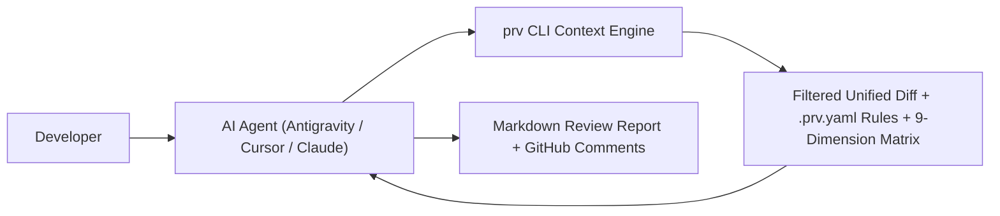

# AI Coding Agent Setup Guides

`prv` is designed to be the universal context engine for AI coding agents. Rather than feeding raw, noisy diffs into an LLM, `prv` filters noise, tags security-sensitive directories, injects team engineering rules from `.prv.yaml`, and structures the review context against the 9-Dimension Engineering Evaluation Matrix.

This directory contains drop-in setup guides and rule files for popular AI agents and coding assistants:

---

## Agent Compatibility Matrix

| AI Agent / Tool | Rule File Location | Integration Type | Guide |
| :--- | :--- | :--- | :--- |
| **Google Antigravity** | `.agents/AGENTS.md`<br>`.agents/skills/prv/SKILL.md` | Native Agent Skill + KacheDB Memory | [Antigravity Guide](antigravity.md) |
| **Cursor IDE** | `.cursor/rules/prv-review.mdc`<br>or `.cursorrules` | Project Rules / Composer Agent | [Cursor Guide](cursor.md) |
| **Claude Code / Desktop** | `CLAUDE.md` | Project Instructions / CLI Tool | [Claude Guide](claude.md) |
| **Headless CLI / Shell** | Terminal pipe / pre-push hooks | Unix Pipeline (`prv bundle \| llm`) | [CLI Pipelines Guide](cli.md) |

---

## How It Works Across All Agents

Every AI agent integration follows the same 4-step workflow:



1. **Trigger:** The developer asks the agent to review a local branch or remote GitHub PR (e.g. `prv bundle --branch feat/auth` or `prv bundle --pr 42`).
2. **Context Gathering:** `prv` bundles unified diffs, filters lockfiles and generated noise, checks `.prv.yaml` sensitive paths, and attaches the 9-dimension checklist.
3. **Advisory Reasoning:** The agent evaluates the bundle as a Staff Engineer sounding board, identifying the **🎯 Weakest Link in the Change** and **⚖️ Architectural Trade-offs**.
4. **Actionable Output:** Findings are formatted using **Conventional Comments** (`🚨 blocking`, `⚠️ issue`, `🔒 security`, `⚡ performance`, `💡 suggestion`, `🔍 nit`) with exact line numbers and copy-ready GitHub suggestion blocks (` ```suggestion `).
