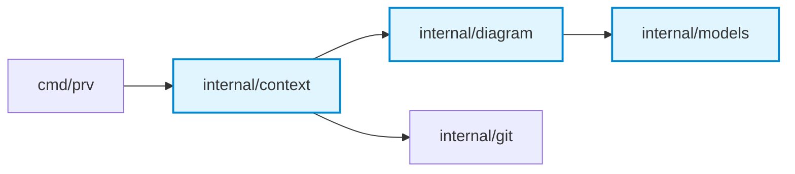

# CLI Usage & Commands

## Installation

### Option 1: Pre-built Binary (GitHub Releases) — Recommended
Download the latest release for your OS and architecture from the [GitHub Releases](https://github.com/vubon/prv/releases/latest) page:

```bash
# 1. Download the archive for your OS (macOS / Linux / Windows)
# Example for macOS (Apple Silicon):
curl -LO https://github.com/vubon/prv/releases/latest/download/prv_darwin_arm64.tar.gz
tar -xzf prv_darwin_arm64.tar.gz

# 2. Make executable and move to your PATH
chmod +x prv
sudo mv prv /usr/local/bin/

# 3. Verify installation
prv version
```

> [!NOTE]
> Pre-compiled binary archives are published on [GitHub Releases](https://github.com/vubon/prv/releases) starting with `v0.2.0-alpha`.
> On macOS, if you encounter Gatekeeper restrictions when running a downloaded binary, run:
> `xattr -d com.apple.quarantine /usr/local/bin/prv`

### Option 2: Using `go install` (Go Developers)
If you have Go 1.26+ installed, install directly into `$GOPATH/bin`:

```bash
go install github.com/vubon/prv/cmd/prv@latest
```

### Option 3: Build from Source (Contributors)
```bash
git clone https://github.com/vubon/prv.git
cd prv

# Build binary into ./bin/prv
make build

# Or install into $GOPATH/bin
make install
```


## Commands

### 1. Pre-Commit Self-Review (Staged Changes)
Run an instant, private pre-commit review on uncommitted staged changes before running `git commit`:

```bash
# Stage your changes
git add internal/auth/ pkg/db/

# Bundle staged changes against repo's .prv.yaml rules and sensitive paths
prv bundle --staged

# Save bundle to file or pipe to clipboard
prv bundle --staged -o staged.md
prv bundle --staged | pbcopy
```

### 2. Bundle Context for a Local Branch
Extract unified diffs and PR metadata for the current or specified local branch:

```bash
# Review current branch against custom base branch (e.g. staging or dev)
prv bundle --base staging
prv bundle -B dev

# Target branch against a custom base branch
prv bundle --branch feat/user-auth --base develop
# or using positional arguments:
prv bundle feat/user-auth staging

# Current or target branch against default base branch (main/master or .prv.yaml)
prv bundle --branch feat/user-auth
prv bundle

# Output review bundle as JSON
prv bundle --base staging --json
```

### 2. Zero-Clone Remote PR Review
Review any GitHub PR without cloning the repository or checking out branches locally:

```bash
# Using PR number (inside a git repository with GitHub remote)
prv bundle --pr 42

# Using full GitHub PR URL
prv bundle --pr https://github.com/org/repo/pull/42
```

### 3. Review a Specific Local Folder
```bash
prv bundle --repo /path/to/another/repo --branch feat/payment
```

### 4. Save Context Bundle to File
Directly save the markdown or JSON bundle to a destination file without flooding stdout:

```bash
# Save to file using --output, --out, or -o
prv bundle --branch feat/user-auth --out bundle.md
prv bundle --pr 1 --output pr-1-bundle.md
```

### 5. Format & Save Review Report
Format a review result JSON and generate a structured markdown report:

```bash
# Save report to reviews/ directory and display terminal summary
prv report --file review-result.json

# Using shorthand flags and custom output directory
prv report -f review-result.json -d reviews/

# Copy all formatted review comments directly to system clipboard
prv report --file review-result.json --copy

# Publish review report directly as a comment on GitHub PR
prv report --file review-result.json --pr 42 --post
prv report -f review-result.json --pr https://github.com/org/repo/pull/42 --post

# Publish complete GitHub Pull Request Review with line-level inline comments on the diff
prv report --file review-result.json --pr 42 --post --inline
```

### 6. Auto-Generated Architecture & Flow Diagrams (Mermaid)
Whenever changes span across package boundaries or introduce package-level dependencies, `prv` automatically analyzes the package import graph and renders a visual Mermaid architecture diagram directly in your context bundle and review reports:



This immediately gives reviewers and LLMs an architectural birds-eye view of component coupling and blast radius before inspecting line-level diffs.

#### Dedicated `prv diagram` Command
You can also generate and extract the raw Mermaid diagram directly without full diff bundles:

```bash
# Generate diagram for current branch against main
prv diagram

# Generate diagram for uncommitted staged changes
prv diagram --staged

# Generate diagram for a specific feature branch
prv diagram -b feat/payment

# Wrap output inside ```mermaid markdown code fence
prv diagram --staged --markdown

# Save diagram directly to a .mmd file
prv diagram --staged -o diagram.mmd
```

### 7. Collapsible File-by-File Changes Walkthrough
To eliminate diff fatigue on large PRs, `prv` generates interactive, collapsible `<details>` blocks summarizing changes, line additions/deletions, sensitive path alerts, and modified function/type symbols for every touched file:

```markdown
<details>
<summary><b>cmd/prv/main.go</b> (+87 / -6) — <i>CLI subcommands & entrypoint</i></summary>

- Modified `main()`
- Modified `runDiagram()`
- Added or updated `runWalkthrough()`
</details>

<details>
<summary><b>internal/output/walkthrough.go</b> (+220 / -0) — <i>Review report & formatting</i></summary>

- Created new file with 220 lines
- Added or updated `FormatWalkthroughMarkdown()`
- Added or updated `GenerateWalkthroughFromFiles()`
</details>
```

#### Dedicated `prv walkthrough` Command
Generate and export file-by-file walkthrough summaries on demand:

```bash
# Generate walkthrough for current branch against main
prv walkthrough

# Generate walkthrough for uncommitted staged changes
prv walkthrough --staged

# Generate walkthrough for a specific feature branch
prv walkthrough -b feat/payment

# Output walkthrough as JSON
prv walkthrough --staged --json

# Save walkthrough directly to a markdown file
prv walkthrough --staged -o walkthrough.md
```

### 8. Repository Configuration (`.prv.yaml`)
Initialize a starter `.prv.yaml` configuration in the current or target directory:

```bash
# Initialize .prv.yaml in current repository
prv init

# Initialize in a specific directory
prv init /path/to/repo
```

You can customize review personas, sensitive directory paths, custom team engineering rules injected into review bundles, and extra noise ignore globs:

```yaml
version: "1"

review:
  # Review persona: "staff-advisory" (default) | "strict-linter" | "mentor"
  persona: "staff-advisory"

  # Strictness settings for review verdicts
  strictness:
    blocking_dimensions:
      - "logic"
      - "security"
      - "blast-radius"

  # Directories requiring extra scrutiny in reviews
  sensitive_paths:
    - "internal/auth/**"
    - "auth/**"
    - "**/auth/**"
    - "migrations/**"
    - "db/migrations/**"
    - "**/migrations/**"
    - "*secret*"
    - "*credential*"

  # Custom engineering standards injected directly into review prompts
  custom_rules:
    - "All database queries must use parameterized placeholders (no string concatenation)"
    - "External HTTP/RPC calls must carry an explicit context with timeout"
    - "Exported Go errors must be wrapped with %w"
    - "No raw goroutines; manage concurrency through worker pools or errgroup"

  # Additional file globs to ignore during diff bundling
  # (Note: lockfiles, *.pb.go, *_generated.go, and minified assets are ignored automatically)
  ignore_patterns:
    - "dist/**"
    - "build/**"
    - "vendor/**"
    - "mocks/**"
    - "**/*_mock.go"
    - "docs/swagger/**"
```

Use a custom config file path during bundle generation:

```bash
prv bundle --branch feat/user-auth --config .prv.prod.yaml
# Or with shorthand -c
prv bundle -b feat/user-auth -c .prv.prod.yaml
```

> [!NOTE]
> In zero-clone `--pr` mode, repository configuration is automatically loaded from `.prv.yaml` if running inside the repository clone, or when explicitly passed via `--config`. For remote PRs evaluated outside their repository, safe defaults are applied.


## Review Flags Reference

### `bundle` Flags
| Flag | Shorthand | Type | Default | Description |
| :--- | :--- | :--- | :--- | :--- |
| `--staged` | `-s` | bool | `false` | Bundle git staged changes (`--cached`) for local pre-commit review |
| `--branch` | `-b` | string | `""` | Target feature branch to review |
| `--base` | `-B` | string | `"main"` | Base branch to compare against (defaults to main/master or .prv.yaml) |
| `--pr` | | string | `""` | GitHub PR number or URL (zero-clone) |
| `--repo` | `-r` | string | `"."` | Path to local Git repository |
| `--config` | `-c` | string | `""` | Path to custom `.prv.yaml` configuration file |
| `--output` | `--out`, `-o` | string | `""` | Save bundle to specific file path |
| `--json` | | bool | `false` | Output bundle as raw JSON |
| `--include-locks`| | bool | `false` | Include lockfiles and generated files in diff |

### `diagram` Flags
| Flag | Shorthand | Type | Default | Description |
| :--- | :--- | :--- | :--- | :--- |
| `--staged` | `-s` | bool | `false` | Generate diagram for git staged changes (`--cached`) |
| `--branch` | `-b` | string | `""` | Target feature branch (defaults to current branch) |
| `--base` | `-B` | string | `"main"` | Base branch to compare against (defaults to main/master or .prv.yaml) |
| `--pr` | | string | `""` | GitHub PR number or URL (zero-clone) |
| `--repo` | `-r` | string | `"."` | Path to local Git repository |
| `--markdown`| `-m` | bool | `false` | Wrap diagram inside ```` ```mermaid ```` code fence |
| `--output` | `--out`, `-o` | string | `""` | Save diagram to specific file path |

### `init` Usage
```bash
prv init [path]
```
Generates a starter `.prv.yaml` configuration file with documented defaults and example rules.

### `report` Flags
| Flag | Shorthand | Type | Default | Description |
| :--- | :--- | :--- | :--- | :--- |
| `--file` | `-f` | string | `""` | Input JSON file for `report` command |
| `--dir` | `-d` | string | `"reviews"`| Output directory for markdown reports |
| `--copy` | `-c` | bool | `false` | Copy formatted comments to clipboard |

---

## AI Agent Integrations

`prv` includes dedicated rule setup guides and integration patterns for leading AI coding assistants:

- 🤖 **[Google Antigravity Guide](agents/antigravity.md)** — Autonomous reviews with `AGENTS.md`, `.agents/skills/prv/`, and KacheDB memory.
- ⚡ **[Cursor IDE Guide](agents/cursor.md)** — Composer & Chat rules via `.cursor/rules/prv-review.mdc`.
- 🧠 **[Claude Code & Claude Desktop Guide](agents/claude.md)** — Project instructions via `CLAUDE.md` and MCP.
- 💻 **[Headless CLI & Terminal Pipelines](agents/cli.md)** — Unix pipes (`prv bundle | llm`) and pre-push hooks.

See the complete **[Agent Compatibility Matrix & Overview](agents/README.md)**.


